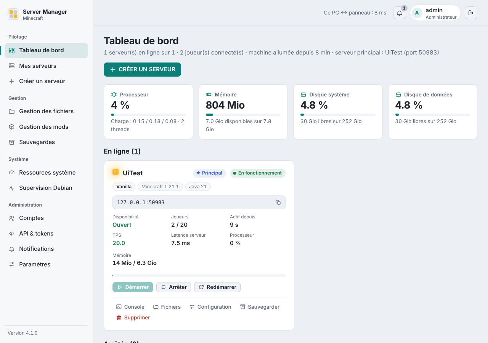

# Minecraft Server Manager

A **private** web panel to create and run several Minecraft servers from a browser: Vanilla, Forge, NeoForge, Fabric, Quilt, Paper, Purpur and more.
It runs on your own Linux machine, for your local network. FastAPI + plain HTML/CSS/JS + SQLite, three direct Python dependencies. The interface and most documentation are in **French**.



## Features
- Server creation (type, version, memory, world, whitelist, `server.properties`), clean start/stop/restart, live console, automatic restart after a crash, several servers at once, a "main" server on port 25565.
- Memory limits computed from the machine's RAM, a system reserve and Java overhead, so a server that could not start is never offered.
- Mod search (Modrinth, CurseForge) with clickable dependencies/incompatibilities, modpack import, mod config editor.
- Monitoring (uptime, TPS, latency, CPU, RAM, per-player Minecraft stats), explained crash reports, notifications in the panel and via Discord webhooks.
- Backups (hot or on stop), verified world archives, an optional "fast disk" tier with a quota for active worlds.
- Admin and limited user accounts, REST API `/api/v1` with scoped tokens.

## Install
Requirements: Linux with **systemd** and **Python 3.11+** (tested on Debian 13), Internet access, ideally a dedicated data disk.

```bash
git clone https://github.com/Spiel3D/minecraft-server-manager.git && cd minecraft-server-manager
sudo bash install.sh                  # data disk mounted on /srv/minecraft-data
sudo bash install.sh --single-disk    # single-disk machine (no dedicated data disk, no fast-disk tier)
```
Options: `--port`, `--admin`, `--data-root PATH`, `--single-disk`, `--no-awake`, `--yes`. Update: `git pull && sudo bash update.sh`.
Uninstall: `sudo bash uninstall.sh` (your servers, worlds and backups are kept). The installer never formats or partitions a disk, never deletes your data, and neither the panel nor any Minecraft server runs as root.

## Portability
Debian 13 is used daily; Ubuntu 24.04 install/update/uninstall were tested in a container with simulated systemd; other systemd distributions and ARM (`aarch64`) are untested; Windows and macOS are not supported.
See [`docs/PORTABILITE.md`](docs/PORTABILITE.md) (French) for the exact status.

## Security
Built for a **trusted local network** only. No HTTPS: do not expose it to the Internet (use a VPN for remote access). Mods and plugins are arbitrary code run with the service user's rights.
See [`SECURITY.md`](SECURITY.md) and [`docs/SECURITE-ET-ARCHITECTURE.md`](docs/SECURITE-ET-ARCHITECTURE.md).

## Status
Personal project. 200+ automated tests use a fake Java, a fake Minecraft server and a simulated network; they do not replace trying real servers, real APIs and real systemd on your machine
(checklist in `docs/TESTS-A-FAIRE-SUR-LA-MACHINE.md`). CurseForge search needs your own API key; Modrinth needs none.

## License
[MIT](LICENSE). *Minecraft* is a trademark of Mojang AB / Microsoft; this project is independent and not affiliated with or endorsed by Mojang, Microsoft, Modrinth, CurseForge (Overwolf), PaperMC or Adoptium.
Before starting a server, the panel asks you to explicitly accept Minecraft's EULA.
