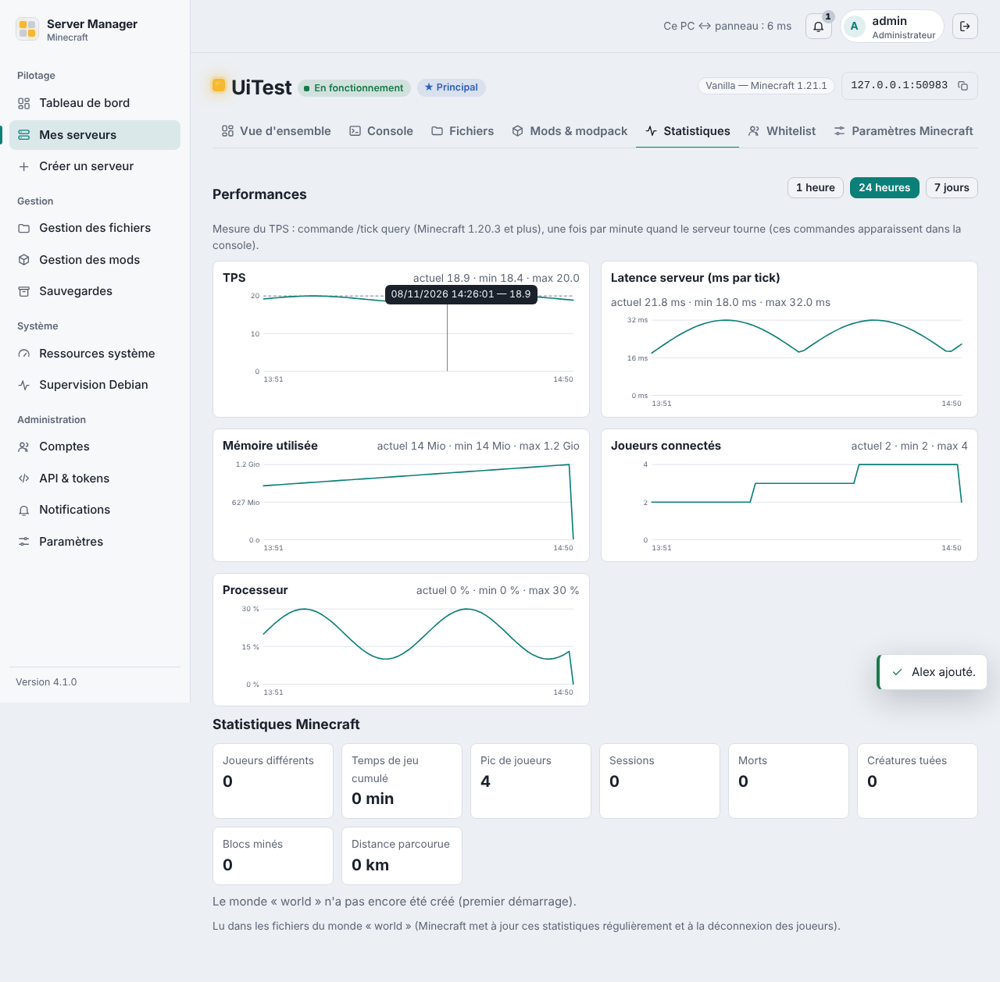
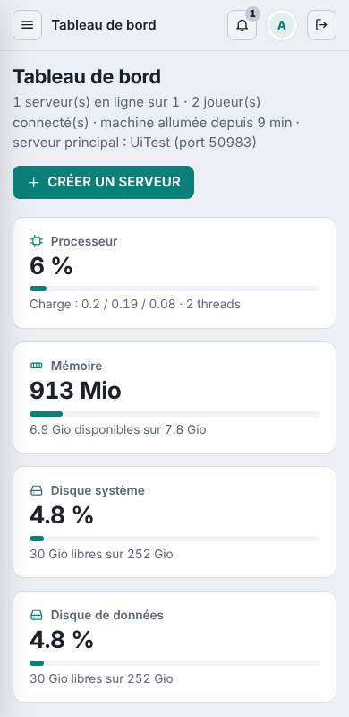

# Minecraft Server Manager

Un panneau web **privé** pour créer et gérer plusieurs serveurs Minecraft depuis un navigateur : Vanilla, Forge, NeoForge, Fabric, Quilt, Paper, Purpur et autres types.
Il tourne sur ta propre machine Linux, pour ton réseau local. FastAPI + HTML/CSS/JS sans framework + SQLite, **trois dépendances Python directes**.

*English summary:* [*README.en.md*](README.en.md)*.*

!\[Tableau de bord](docs/images/tableau-de-bord.png)

## Ce qu'il fait

* **Serveurs** : création en quelques clics (type, version, mémoire, monde, whitelist, `server.properties`), démarrage/arrêt propre/redémarrage,
console en direct, relance automatique après un plantage, plusieurs serveurs en même temps, un « serveur principal » sur le port 25565.
* **Mémoire** : le maximum proposé pour chaque serveur tient compte de la RAM de la machine, d'une réserve système et de la marge de Java ; un serveur qui ne pourrait pas démarrer n'est pas proposé.
* **Mods et modpacks** : recherche Modrinth et CurseForge, dépendances et incompatibilités affichées avec des liens cliquables, import de modpacks, éditeur de configuration de mods.
* **Surveillance** : disponibilité, TPS, latence, CPU, RAM, statistiques Minecraft par joueur, historique, rapports de plantage expliqués, notifications dans le panneau et sur Discord (webhook).
* **Sauvegardes et mondes** : sauvegardes manuelles ou automatiques (à chaud ou à l'arrêt), restauration, archivage vérifié d'un monde, quota « SSD » pour garder les mondes actifs sur le disque rapide.
* **Comptes** : administrateur et utilisateurs limités à leurs serveurs, API REST `/api/v1` avec tokens à portée limitée.

<p>


</p>

## Installation rapide

Il te faut une machine **Linux avec systemd et Python 3.11+** (testé sur Debian 13), un accès Internet et, de préférence, un disque dédié aux données.

```bash
git clone https://github.com/Spiel3D/minecraft-server-manager.git
cd minecraft-server-manager
sudo bash install.sh                  # disque de données monté sur /srv/minecraft-data
# ou, sur une machine à disque unique :
sudo bash install.sh --single-disk
```

L'installateur te demande le mot de passe administrateur, puis affiche l'adresse du panneau (`http://<ip-de-la-machine>:8080`).
Options : `--port`, `--admin`, `--data-root CHEMIN`, `--single-disk`, `--no-awake`, `--yes`. Détails : [`docs/INSTALLATION.md`](docs/INSTALLATION.md).

Mise à jour : `git pull \&\& sudo bash update.sh` (sauvegarde, migration, retour arrière automatique en cas d'échec, serveurs Minecraft non interrompus).
Désinstallation : `sudo bash uninstall.sh` (**tes serveurs, mondes et sauvegardes sont conservés**).

**Ce que l'installateur ne fait jamais** : formater ou partitionner un disque, supprimer ou écraser tes données, toucher au réseau, au pare-feu ou à l'environnement de bureau,
exécuter le panneau ou un serveur en root (tout tourne sous l'utilisateur système `minecraft-panel`).

## Est-ce portable ?

Oui sur Linux avec systemd, mais seuls Debian 13 (usage quotidien) et Ubuntu 24.04 (installation testée en simulation) ont été essayés ; Windows et macOS ne sont pas pris en charge.
Tout est détaillé, avec ce qui est testé et ce qui ne l'est pas, dans [`docs/PORTABILITE.md`](docs/PORTABILITE.md).

## Sécurité : à lire avant d'installer

* Le panneau est fait pour un **réseau local de confiance**. Il refuse par défaut toute adresse hors réseaux privés. **Pas de HTTPS** : ne l'expose pas sur Internet (pas de redirection de port ; un VPN si besoin d'un accès distant).
* Les **mods et plugins sont du code arbitraire** exécuté avec les droits de l'utilisateur du service : installe des sources de confiance.
* Politique de signalement des failles : [`SECURITY.md`](SECURITY.md). Architecture et mesures : [`docs/SECURITE-ET-ARCHITECTURE.md`](docs/SECURITE-ET-ARCHITECTURE.md).

## Documentation

|||
|-|-|
|[`docs/INSTALLATION.md`](docs/INSTALLATION.md)|Installer, mettre à jour, revenir en arrière, désinstaller, réglages|
|[`docs/UTILISATION.md`](docs/UTILISATION.md)|Usage quotidien dans l'interface|
|[`docs/PORTABILITE.md`](docs/PORTABILITE.md)|Systèmes pris en charge, disque unique, chemins personnalisés|
|[`docs/SECURITE-ET-ARCHITECTURE.md`](docs/SECURITE-ET-ARCHITECTURE.md)|Modèle de sécurité et architecture|
|[`docs/TESTS-A-FAIRE-SUR-LA-MACHINE.md`](docs/TESTS-A-FAIRE-SUR-LA-MACHINE.md)|Ce qui est vérifié automatiquement, et ce qui reste à valider sur la vraie machine|
|[`docs/V3-LOT1.md`](docs/V3-LOT1.md), [`docs/V4.md`](docs/V4.md), [`CHANGELOG.md`](CHANGELOG.md)|Historique des versions|

## État du projet

Projet personnel, utilisé par son auteur sur une machine Debian 13. Les 200+ tests automatiques utilisent un faux Java, un faux serveur Minecraft et un réseau simulé :
ils ne remplacent pas un essai avec de vrais serveurs, de vraies API (Mojang, Paper, Modrinth, CurseForge) et un vrai systemd, que chacun doit faire chez soi (liste dans `docs/TESTS-A-FAIRE-SUR-LA-MACHINE.md`).
Le bot Discord et l'ouverture de port sur la box ne sont pas fournis (webhooks Discord seulement ; l'ouverture du port reste manuelle).

Pour la recherche de mods CurseForge, il faut **ta propre clé API** (à saisir dans Paramètres) ; Modrinth n'en demande pas.

## Contribuer

Voir [`CONTRIBUTING.md`](CONTRIBUTING.md). Lancer les tests : `pip install -r requirements-dev.txt \&\& python -m pytest -q`.

## Licence et mentions

[MIT](LICENSE). *Minecraft* est une marque de Mojang AB / Microsoft. Ce projet est indépendant et n'est ni affilié à, ni approuvé par Mojang, Microsoft, Modrinth, CurseForge (Overwolf), PaperMC ou Adoptium.
Avant de démarrer un serveur, le panneau demande d'accepter explicitement le contrat de licence (EULA) de Minecraft.

